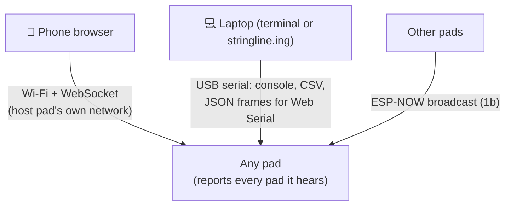
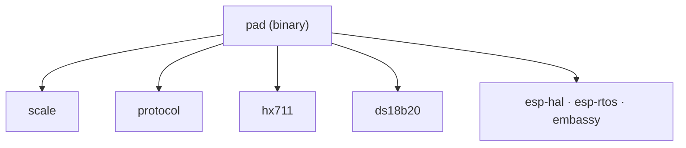
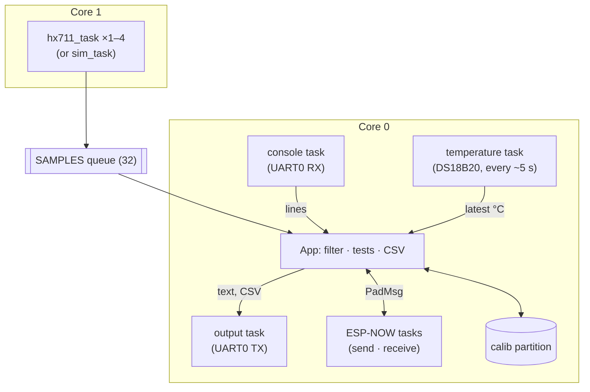
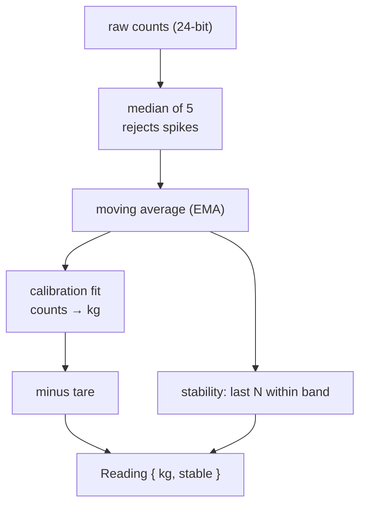

# Architecture

How the pieces fit together. For *why* and the build plan, see [plan.md](plan.md).

**Contents:** [System](#system) · [Repo map](#repo-map) · [Pad firmware](#pad-firmware) · [Signal chain](#signal-chain) · [Flash layout](#flash-layout) · [Interfaces](#interfaces) · [Status](#status)

## System

Every board is a **pad**. Pads broadcast to each other, so connecting to **any** pad gives all four readings. The UI lives in apps (e.g. stringline.ing) that speak the [scales protocol](scales-protocol.md).

Solid = built. Dashed = planned.

## Repo map

| Path | What |
| --- | --- |
| `firmware/crates/scale` | Filter, tare, calibration, corner math, bench-test statistics |
| `firmware/crates/protocol` | Wire formats: console commands, CSV rows, `PadMsg`, flash records |
| `firmware/crates/hx711` | HX711 bit-bang driver |
| `firmware/crates/ds18b20` | DS18B20 one-wire driver |
| `firmware/pad` | The binary for ESP32-S3 (and ESP32 for bench work) |
| `web/` | Phone UI (phase 1b) |
| `docs/` | Plan, wiring, assembly, test protocol |

The four crates are `no_std`, hardware-independent and tested on the host with `cargo test`. Only `pad/` touches ESP hardware.

## Pad firmware

Two cores, connected by a queue. Core 1 only samples, so radio and web work on core 0 can't disturb the HX711's timing.

| File | Role |
| --- | --- |
| `main.rs` | Pin map, starts tasks and core 1 |
| `sampler.rs` | Reads the HX711 (or simulates one), pushes raw counts |
| `app.rs` | Main loop: commands, filtering, bench tests, CSV |
| `console.rs` / `out.rs` | Serial input with echo / output queue |
| `calib_store.rs` | Saves and loads calibration |
| `temperature.rs` | Probe reading, shared as an atomic |
| `link.rs` | ESP-NOW: broadcast readings and commands, collect others' |
| `pads.rs` | Pad names, corners, remote pads by MAC, press-to-assign |
| `led.rs` | LED patterns: find-me blink, host on/off |
| `button.rs` | BOOT button: hold 5 s to toggle host; sim "press" |
| `web.rs` | Host pad: Wi-Fi access point, DHCP, captive DNS, HTTP + WebSocket |

## Signal chain

Per channel, all in `scale`:

- **Calibration:** least-squares line through up to 16 points. Residuals show nonlinearity.
- **Tare** is stored in counts, so it survives recalibration.
- **Bench tests** (`scale::bench`) consume `Reading`s. Pass targets scale with full-scale rating (200 kg bench, 2,000 kg car pad).

## Flash layout

From [`partitions.csv`](../firmware/pad/partitions.csv). It fits 4 MB, so both board types use it.

| Partition | Size | Use |
| --- | --- | --- |
| `nvs` | 20 KB | Reserved (radio) |
| `otadata` | 8 KB | Which app slot boots |
| `ota_0` / `ota_1` | 1.75 MB each | App slots for OTA updates |
| `calib` | 8 KB | Two-slot record with CRC: calibration + corner. Never touched by app updates. |

## Interfaces

| Interface | Format | Defined in |
| --- | --- | --- |
| Serial console | Text commands (`help` lists them) | `protocol::command` |
| CSV stream | `t_ms,ch,raw,filtered,kg,stable,temp_c` | `protocol::csv` |
| Pad ↔ pad | ESP-NOW broadcast, channel 1: 19-byte `PadMsg` readings, 13-byte `CmdMsg` commands (sent 3×) | `protocol::PadMsg`, `protocol::cmd_msg` |
| Apps (e.g. stringline.ing) | JSON lines over USB serial (Web Serial); BLE planned | [scales-protocol.md](scales-protocol.md) |

## Status

| Piece | State |
| --- | --- |
| Host crates + tests | ✅ Built |
| Pad firmware: sampling, console, calibration, bench tests, CSV | ✅ Builds; untested on hardware |
| ESP-NOW between pads, `pads` view | ✅ Builds; untested on hardware |
| Scales protocol over USB serial (`json on`) | ✅ Builds; untested on hardware |
| Pad names, press-to-assign corners, blink, tare all | ✅ Tested on 2 ESP32s (sim) |
| Web UI on the host pad's Wi-Fi (`web/`) | ✅ Tested: 2 ESP32s (sim) + iPhone (captive portal, Safari, assign walk-through) |
| Garage Wi-Fi (join an existing network) | ⏳ Later |
| BLE for Web Bluetooth | ⏳ Maybe |
| OTA updates | ⏳ Later (partition slots already in place) |
