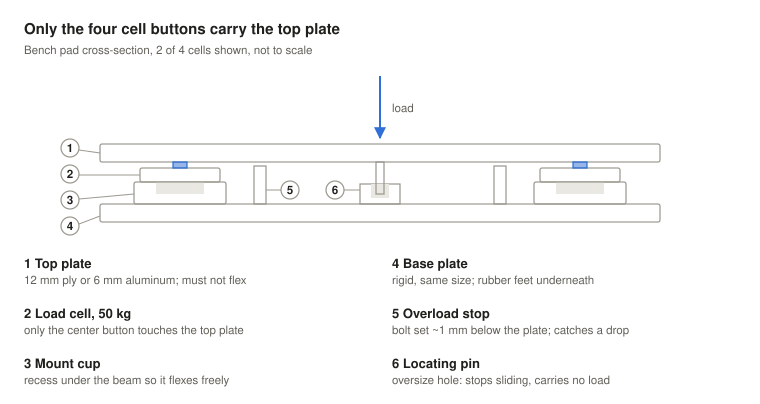
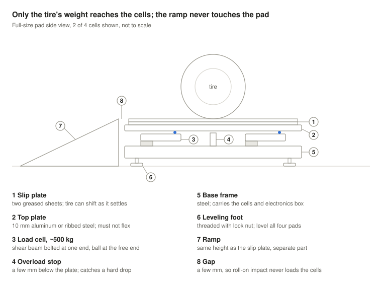

# Assembly

**Contents:** [Bench pad](#bench-pad-phase-1) · [Steps](#steps) · [Full-size pad](#full-size-pad-phase-2)

## Bench pad (phase 1)

A 300 × 300 mm top plate on four 50 kg cells, one per corner. Same topology as a car pad at one-tenth the load.

**The one rule: only the four cell buttons may touch the top plate.** Any other contact bypasses the cells, and the pad then reads consistently and wrongly.

| Part | Spec |
| --- | --- |
| Top plate | 12 mm birch ply or 6 mm aluminum; must not flex |
| Base plate | Same size; rigid; rubber feet underneath |
| Mount cups | Printed or turned; recess under each cell so its beam flexes freely |
| Overload stops | M6 bolts set ~1 mm below the plate |
| Locating pin | In an oversize hole; stops sliding, carries no load |
| Edge gap | 3–5 mm all round |

## Steps

1. Cut both plates. Mark the four cell positions the same distance from each corner.
2. Bolt (or VHB-tape) the mount cups to the base. Seat the cells.
3. Fit the overload stops. Set them so the plate lands on them **before** any cell passes 50 kg.
4. Fit the locating pin.
5. Lower the top plate onto the cell buttons. Check the edge gap with a feeler gauge all the way round.
6. Threadlocker on every fastener.
7. Wire it up: [wiring.md](wiring.md).
8. Run the off-center test ([test-protocol.md](test-protocol.md)). If readings disagree, something is binding or touching. Fix that before anything else.

## Full-size pad (phase 2)

Same design, ~2,000 kg: four ~500 kg shear-beam cells, a 400 × 400 mm top plate in 10 mm aluminum or ribbed steel, ramps, and a slip plate.

- The ramp is a **separate part** with a gap to the pad, so roll-on impact never loads the cells. Put it on a rubber mat so it can't creep.
- Size the stops so a bouncing car lands on them, not on the cells.
- Seal the electronics box against dust and water.
- Drawings will live in [`hardware/`](../hardware/).
